# EdgeMason — Full report

**Date:** 2026-10-05/06
**Branch:** `abhay` (changes not committed yet)
**Contents:**
1. Summary
2. What EdgeMason does
3. Problems found
4. Changes made and their impact
5. Experimental results and discussion (for the slide)
6. Validation
7. Limitations and open items
8. Slide content (copy-paste)
9. Reproducing everything

All raw data is in `reports/data/` and all figures are in `reports/img/`. Every number in
the results tables was generated from those JSON files by `scripts/results_tables.py`.

---

## 1. Summary

EdgeMason takes a trained ONNX model and calibration images, tries several optimized
versions (FP32, INT8, ONNX Runtime or TVM), benchmarks them for a chosen edge device,
picks the best one under the user's constraints, and packages it as a ZIP that runs on
that device.

An audit of the `abhay` branch found that the pipeline ran end to end, but:
- the target device had no effect on the result
- two of its ranking metrics were wrong
- accuracy was graded on the calibration images
- the downloaded package crashed
- the server froze during a run

Ten fixes were made. They are summarised below and in section 4.

| What | Before | After |
|---|---|---|
| Static INT8 top-1 (MobileNetV2, held-out images) | 51.4% | **57.5%** (FP32: 58.1%) |
| Accuracy graded on images not used for calibration | No | **Yes** (seeded 30/70 split) |
| Memory reading per model | ~0 MB for every model | **FP32 43.0 MB, INT8 23.5 MB** (MobileNetV2) |
| Does the target device change the winner? | No | **Yes** |
| FP32 p50 over 3 identical deploys | 11.9 / 18.4 / 14.2 ms | **13.1 / 14.3 / 13.1 ms** |
| Server `/health` during a deploy, slowest answer | **31,324 ms** (frozen) | **13.9 ms** |
| Candidates for a CNN | 3, incl. dynamic INT8 (2.4× slower than FP32) | **2** (FP32, static INT8) |
| Deploy time (MobileNetV2, CPU) | ~30 s | **~19 s** |
| Downloaded package | crashed on every run | **runs in a clean Python environment** |
| Backend code | one 460-line `api/main.py` | `routes/` + `services/` modules |
| Tests | — | **83 passed**, 1 skipped (needs `torch`) |

**Main experimental results** (6 CNNs, x86_64 CPU, 1 thread, 179 held-out ImageNetV2 images):
- **Static INT8 is 3.5–3.9× smaller for every model,** and its top-1 accuracy is within 2.3
  points of FP32 for all six. The largest drops are ShuffleNet (−2.3) and SqueezeNet (−2.2);
  ResNet-152 is identical.
- **INT8's speed-up grows with model size:** 1.17× for MobileNetV2, 1.46× for ResNet-50 and
  1.75× for ResNet-152. On the two smallest models INT8 is **slower** (0.75×, 0.87×), so the
  pipeline must measure rather than assume.
- **Calibration size:** 5–10 images are enough. Fewer than 5 can lose 6–8 points on
  ShuffleNet and ResNet-18. More data does **not** fix per-tensor quantization; per-channel does.
- **TVM:** it compiles and runs all three models correctly, with the same FP32 accuracy.
  Untuned, it is 21–57× slower than ONNX Runtime.

---

## 2. What EdgeMason does

```
upload ONNX model + calibration images
  → analyze (size, parameters, operators, model family)
  → plan candidates (rule-based, by model family and constraints)
  → quantize (FP32 / static INT8 / dynamic INT8; optional TVM compile)
  → benchmark each candidate (fresh process, latency + memory)
  → score accuracy (held-out images)
  → estimate on the target device
  → rank by priority (latency / memory / accuracy / balanced) and limits
  → package the winner (ZIP: model, inference.py, requirements, Dockerfile, README)
```

**Code layout after the refactor:**

| Folder / file | Role |
|---|---|
| `api/main.py` | Creates the app and includes the routers (10 lines) |
| `api/config.py` | Upload limits, benchmark settings, valid options |
| `api/routes/` | HTTP only: `pages.py`, `analyze.py`, `deploy.py`, `artifacts.py` |
| `api/services/` | Logic: `pipeline.py`, `ranking.py`, `hardware.py`, `model_validation.py`, `uploads.py`, `artifacts.py` |
| `api/optimizer/` | `quantizer.py`, `benchmark_engine.py`, `benchmark_worker.py`, `validation.py`, TVM helpers |
| `api/planner/rule_based.py` | Chooses candidates |
| `api/packager/generator.py` | Builds the deployment ZIP |
| `profiles/hardware_profiles.json` | Per-device providers, latency multipliers, memory factor |

---

## 3. Problems found (audit of the `abhay` branch)

| # | Problem | Severity | Status |
|---|---|---|---|
| A1 | Target device never changed the winner; ranking used laptop latency; one multiplier per device for every model type | wrong result | **Fixed** (Fix 2) |
| A2 | "Auto" ran FP32 on the GPU and INT8 on the CPU, so FP32 "won" even for a Raspberry Pi | wrong result | **Fixed** (Fix 1) |
| A3 | Accuracy graded on the calibration images (~+7 points too optimistic) | wrong result | **Fixed** (Fix 7) |
| A4 | Memory measured after loading, so always ~0; "memory" priority picked the largest model | wrong result | **Fixed** (Fix 8) |
| A5 | Latency limit checked against laptop latency | wrong result | **Fixed** (Fix 3) |
| A6 | Package `inference.py` crashed (`{{ }}` typo); ARM-only Dockerfile; onnxruntime pinned to 1.18 | broken | **Fixed** (Fix 10) |
| A6b | ZIP deleted after the first download | broken | Open (Fix 11, deferred) |
| A7 | Planner added dynamic INT8, the slowest CNN option, exactly when latency mattered; README said 50 MB, code used 5 MB | misleading | **Fixed** (Fix 5) |
| A8 | Static INT8 per-tensor, no pre-processing: −10 points on MobileNetV2 | wrong result | **Fixed** (Fix 4) |
| B1 | TVM not built for the target (x86 code for "rpi4"), untuned, 15–25× slower; UI turns it on by default | misleading | Explained; open (Fix 13) |
| B2 | Benchmarks too short (2+5 runs) | misleading | **Fixed** (Fix 9) |
| B3 | Server stopped responding during a run | broken | **Fixed** (Fix 12) |
| B4 | Operator chart dominated by `Constant` | polish | Open |
| C1–C11 | Dashboard issues: 0 shown as `--`, static progress steps, hard-coded "API Online", raw JSON errors, no provider column, CDN dependencies, "EdgeForge" vs "EdgeMason" naming, no folder upload | polish | Mostly open; CPU is now the default provider |

---

## 4. Changes made and their impact

### Refactor: split `api/main.py`
- **Before:** routes, validation, the pipeline, ranking and file handling were all in one file.
- **After:** `routes/` holds HTTP handling only and `services/` holds the logic. The endpoints
  and response shape are unchanged.
- **Impact:** each piece can be tested on its own. `services/ranking.py`,
  `services/hardware.py` and the pipeline each have their own tests.

### Fix 1: one execution provider per deploy
- **Change:**
  - Each hardware profile lists `execution_providers` in order of preference: `["cpu"]` for
    the Raspberry Pis, `["cuda", "cpu"]` for Jetson Nano and x86_64.
  - `select_execution_provider()` picks **one** provider per deploy, and every candidate uses it.
  - Auto stays on CPU when TVM is included.
  - An explicit `cuda` request is rejected for CPU-only targets.
- **Plain-language GPU warning:** a candidate that cannot run on the GPU fails visibly, with a
  plain-language warning: *"onnx_static_int8 cannot run on the GPU: some of its static_int8
  operations are only supported on the CPU… Choose the CPU execution provider to compare it."*
- **Decision:** CPU by default, GPU optional. Both dashboards default to **CPU**.
- **Impact:** FP32 and INT8 always race on the same hardware.

### Fixes 2 and 3: the target device matters
- **Change:**
  - **Per-type multipliers:** `latency_scaling_by_quantization` gives each device its own INT8
    multiplier; FP32 keeps `latency_scaling_factor`.
  - **Ranking and limits:** they use **host p50 × multiplier**.
  - **Visible estimate:** the dashboards and the package README show it.
- **Impact:** the winner now changes with the target (section 5.4).
- **Caveat:** the INT8 multipliers for ARM targets are placeholders until measured on a real device.

### Fix 4: per-channel static INT8
- **Change:** `per_channel=True` (one weight scale per output channel), plus ONNX Runtime's
  `quant_pre_process` step.
- **Impact:** MobileNetV2 static INT8 top-1 went from **51.4% to 57.5%** (FP32: 58.1%), at the
  same speed. Section 5.8 shows all 6 models.

### Fix 5: no dynamic INT8 for CNNs
- **Change:**
  - **Model family:** the planner classifies the model from the analyzer's operator counts:
    `cnn` (more Conv than MatMul/Gemm), `matmul` or `unknown`.
  - **Method labels:** candidates are labelled by method (`fp32`, `static_int8`,
    `dynamic_int8`) for both ONNX Runtime and TVM.
  - **CNN rule:** CNNs never get `dynamic_int8`. A CNN without calibration data gets FP32 only,
    plus a warning to upload calibration images.
- **Why:** on MobileNetV2, dynamic INT8 was 2.4× slower than FP32 (`QUInt8` weights).
  With `QInt8` weights it was 7.6× slower. The overhead comes from 53 `DynamicQuantizeLinear`
  steps, one before every Conv.
- **Impact:** one fewer candidate for CNNs, and deploys went from ~30 s to ~19 s.
  Transformer-style models are unchanged.

### Fixes 6 and 7: calibration and test data kept apart
- **Change:**
  - **Split:** a labeled `.npz` is shuffled with a fixed seed. 30% (at most 300 images)
    calibrates; the rest scores **every** candidate.
  - **Limit:** raised from 256 to 1000 images.
  - **Warnings:** below 100 calibration images, and below 200 test images (with the ± margin).
- **Impact:** accuracy is no longer flattered by grading on the calibration images
  (section 5.6 shows the gap).

### Fix 8: real memory measurement
- **Change:**
  - **Fresh process:** each candidate is benchmarked in its own process
    (`api/optimizer/benchmark_worker.py`).
  - **Measurement:** the baseline is taken before loading the model; the peak is Linux `VmHWM`,
    reset at the baseline.
  - **Result:** memory = peak − baseline. The target estimate = memory × `memory_overhead_scaling`.
- **Bug found and fixed:** `ru_maxrss` keeps the parent process's memory after the child
  process starts, so it reported ~630 MB for every model. Switched to `VmHWM`.
- **Impact:**
  - **Real values:** FP32 43.0 MB vs INT8 23.5 MB (MobileNetV2), and 255 vs 77 MB (ResNet-50).
  - **Stable readings:** they did not change while the server's own memory grew from 429 to 524 MB.

### Fix 9: enough warm-up and timed runs
- **Change:**
  - **Runs:** up to 10 warm-up and 100 timed runs.
  - **Time limit:** timing stops after about 10 s, but never before 10 timed runs.
  - **Reporting:** the response reports `warmup_runs`, `timed_runs` and p95.
- **Impact:** FP32 p50 across 3 deploys went from 11.9/18.4/14.2 ms to 13.1/14.3/13.1 ms.
  ResNet-152 is capped at about 16 s per candidate instead of about 42 s.

### Fix 10: a ZIP that runs on the target
- **Change:**
  - **One `inference.py` for every winner:** it finds `model.onnx` or `model_tvm.tar` and loads
    ONNX Runtime or TVM. Usage: `python inference.py [input.npy]` or `Model().predict(array)`.
  - **Multi-arch Dockerfile** (`python:3.11-slim`) installing from `requirements.txt`.
  - **Exact tested versions pinned:** `onnxruntime==1.27.0` (the CPU package), `numpy==1.26.4`.
  - **Package README:** the input shape and the expected latency, memory and accuracy on the target.
  - **Quiet runtime:** onnxruntime's harmless warnings are hidden (140 lines → 0).
- **Impact, verified:**
  - **Clean environment:** the ZIP runs in a brand-new Python environment and classified a
    real image correctly (12/20 sample images correct).
  - **Docker:** the image builds and runs on x86.
  - **Every model:** all three full-pipeline ZIPs (3.1, 20.1 and 47.4 MB) passed their self-test.
  - **Not yet tested on ARM hardware.**

### Fix 12: the server stays responsive
- **Change:** `/deploy` and `/analyze` run their blocking work with `run_in_threadpool`.
  Deploys still run one at a time (`asyncio.Semaphore(1)`), so benchmarks don't disturb each other.
- **Impact:** `scripts/measure_responsiveness.py`, one ~30 s deploy:

| While a deploy runs | Before | After |
|---|---|---|
| `/health` requests answered | 3 | 115 |
| Slowest `/health` answer | 31,324 ms | 13.9 ms |
| Requests slower than 1 s | 1 | 0 |

---

## 5. Experimental results and discussion

### 5.1 Model setting and protocols

| Model | Params | Size (FP32) | Source | Family |
|---|---|---|---|---|
| SqueezeNet 1.1 | 1.2 M | 4.7 MB | ONNX Model Zoo (opset 7 → 13) | CNN, no BatchNorm |
| ShuffleNet V2 | 2.3 M | 8.8 MB | ONNX Model Zoo (opset 10 → 13) | CNN |
| MobileNetV2 | 3.5 M | 13.3 MB | project model | CNN, depthwise convolutions |
| ResNet-18 | 11.7 M | 44.7 MB | ONNX Model Zoo (opset 8 → 13) | CNN |
| ResNet-50 | 25.5 M | 97.4 MB | project model | CNN |
| ResNet-152 | 60.1 M | 229.4 MB | project model | CNN |

- **Pretrained models; no training is done.** EdgeMason optimizes trained models. The
  "training/validation" bullet is therefore covered by the **calibration** set (what the
  quantizer learns from) and the **test** set (what accuracy is measured on).
- **Data:** ImageNetV2, 256 labeled images, one per class (`scripts/prepare_imagenetv2_subset.py`).
  Preprocessing: resize to 232, centre-crop 224, ImageNet mean/std, NCHW float32.
- **Split:** shuffled with a fixed seed. **77 calibration / 179 test** images for the main
  results. The calibration-size study uses a pool of 100 calibration images and a fixed
  test set of 156.
- **Quantization:**
  - **Static INT8:** ONNX Runtime QDQ, S8S8, **per-channel** weights, MinMax calibration,
    `quant_pre_process` first.
  - **Dynamic INT8:** `QUInt8` weights.
  - **TVM:** Relax compiler, generic LLVM target, **no auto-tuning**. TVM INT8 = the static
    INT8 model compiled by TVM.
- **Opset upgrade:** the Model Zoo models were upgraded to opset 13 with
  `onnx.version_converter`. The outputs are identical (100% same predictions, zero difference
  in logits). This was needed because per-channel INT8 requires opset ≥ 13 (finding in section 7).

### 5.2 Benchmark setting

| Setting | Value |
|---|---|
| Host | Intel i7-13620H laptop (AVX2 + AVX-VNNI), 16 logical cores; NVIDIA GPU present but not used |
| Software | Python 3.11, onnxruntime 1.27.0, numpy 1.26.4, apache-tvm 0.26.0 |
| Execution provider | CPU |
| Threads | **1** (`intra_op_num_threads = inter_op_num_threads = 1`) |
| Runs | up to 10 warm-up + 100 timed, 10 s limit, at least 10 timed |
| Isolation | each candidate in a fresh process, one candidate at a time |
| Memory | peak RSS (`VmHWM`) − baseline taken before loading |
| Input | batch 1, 3×224×224 |

**Why one thread:** we estimate a device's speed as *laptop time × a multiplier*. That only
works if we compare like with like: one laptop core against one device core. With all 16
laptop cores, the multiplier would also have to capture "16 cores vs 4". That part depends
on the model, since big models parallelize better than small ones, so no single multiplier
would be right.

One thread also gives repeatable numbers (the laptop mixes fast and slow cores) and a fair
race, because untuned TVM uses a single core anyway.

The estimates are therefore **single-core** and conservative. The packaged model uses all of
the device's cores and should run faster (typically 2–3× on 4 cores).

### 5.3 Evaluation measures
- **Top-1 / top-5 accuracy** on held-out test images. With 179 images, the ±95% margin is
  about ±7 points; with 35 images, about ±16 points.
- **FP32 vs INT8 agreement:** a 2×2 matrix of whether each model is right or wrong on the same
  image, plus the share of identical top-1 predictions. This is our confusion matrix.
- **Latency:** p50 (median) per image; p95 is also recorded.
- **Throughput:** images per second.
- **Model size:** file size.
- **Memory:** peak RAM minus baseline.
- **Speed-up:** FP32 p50 ÷ INT8 p50.
- **Estimated latency/memory on the target:** host value × the device multiplier.

### 5.4 Performance analysis

**FP32 vs static INT8, all six models** (ONNX Runtime, 1 thread, 179 test images):

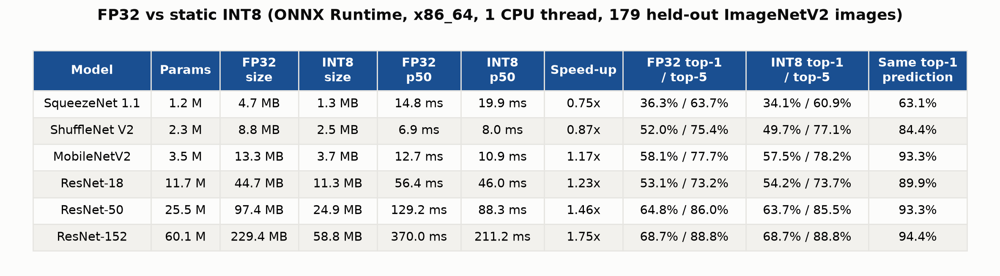

| Model | Params | FP32 size | INT8 size | FP32 p50 | INT8 p50 | Speed-up | FP32 top-1 / top-5 | INT8 top-1 / top-5 | Same prediction |
|---|---|---|---|---|---|---|---|---|---|
| SqueezeNet 1.1 | 1.2 M | 4.7 MB | 1.3 MB | 14.8 ms | 19.9 ms | 0.75x | 36.3% / 63.7% | 34.1% / 60.9% | 63.1% |
| ShuffleNet V2 | 2.3 M | 8.8 MB | 2.5 MB | 6.9 ms | 8.0 ms | 0.87x | 52.0% / 75.4% | 49.7% / 77.1% | 84.4% |
| MobileNetV2 | 3.5 M | 13.3 MB | 3.7 MB | 12.7 ms | 10.9 ms | 1.17x | 58.1% / 77.7% | 57.5% / 78.2% | 93.3% |
| ResNet-18 | 11.7 M | 44.7 MB | 11.3 MB | 56.4 ms | 46.0 ms | 1.23x | 53.1% / 73.2% | 54.2% / 73.7% | 89.9% |
| ResNet-50 | 25.5 M | 97.4 MB | 24.9 MB | 129.2 ms | 88.3 ms | 1.46x | 64.8% / 86.0% | 63.7% / 85.5% | 93.3% |
| ResNet-152 | 60.1 M | 229.4 MB | 58.8 MB | 370.0 ms | 211.2 ms | 1.75x | 68.7% / 88.8% | 68.7% / 88.8% | 94.4% |

**Full pipeline on x86_64, all four candidates** (MobileNetV2 and ResNet-50 on 179 test
images; ResNet-152 on the 50-image file, so 15 calibration / 35 test images):

| Model | Candidate | p50 (1 core) | Timed runs | RAM (peak - baseline) | Size | Top-1 | Test images |
|---|---|---|---|---|---|---|---|
| MobileNetV2 | FP32 (ONNX Runtime) | 17.5 ms | 10+100 | 43.0 MB | 13.3 MB | 58.1% | 179 |
| MobileNetV2 | Static INT8 (ONNX Runtime) (winner) | 15.2 ms | 10+100 | 23.5 MB | 3.7 MB | 57.5% | 179 |
| MobileNetV2 | FP32 (TVM, untuned) | 375.0 ms | 7+26 | 52.0 MB | 12.6 MB | 58.1% | 179 |
| MobileNetV2 | INT8 (TVM, untuned) | 284.4 ms | 9+34 | 28.1 MB | 3.5 MB | 58.1% | 179 |
| ResNet-50 | FP32 (ONNX Runtime) | 131.0 ms | 10+75 | 255.0 MB | 97.4 MB | 64.8% | 179 |
| ResNet-50 | Static INT8 (ONNX Runtime) (winner) | 85.3 ms | 10+100 | 76.6 MB | 24.9 MB | 63.7% | 179 |
| ResNet-50 | FP32 (TVM, untuned) | 6558.8 ms | 1+10 | 388.9 MB | 90.8 MB | 64.8% | 179 |
| ResNet-50 | INT8 (TVM, untuned) | 6803.5 ms | 1+10 | 98.2 MB | 20.5 MB | 63.1% | 179 |
| ResNet-152 | FP32 (ONNX Runtime) | 368.0 ms | 7+27 | 517.6 MB | 229.4 MB | 80.0% | 35 |
| ResNet-152 | Static INT8 (ONNX Runtime) (winner) | 217.0 ms | 10+45 | 144.2 MB | 58.8 MB | 74.3% | 35 |
| ResNet-152 | FP32 (TVM, untuned) | 20896.9 ms | 1+10 | 917.4 MB | 213.8 MB | 80.0% | 35 |
| ResNet-152 | INT8 (TVM, untuned) | 19091.7 ms | 1+10 | 233.5 MB | 48.1 MB | 74.3% | 35 |

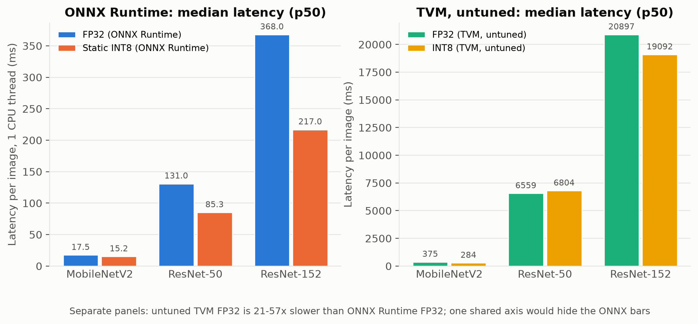

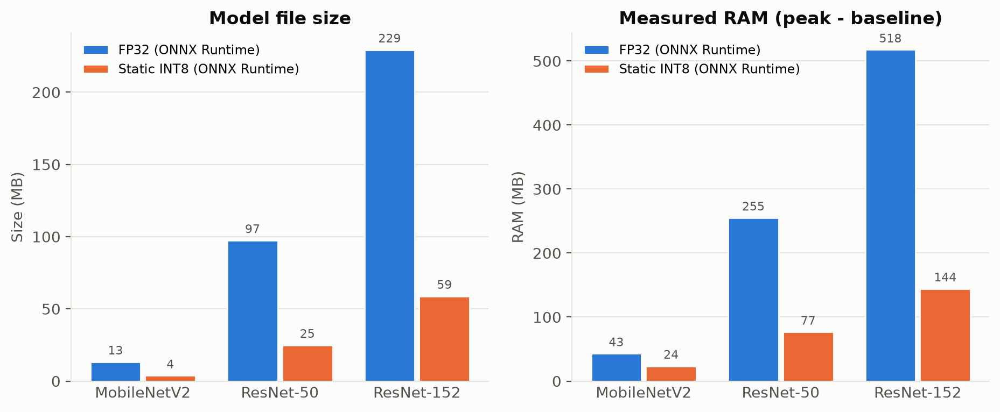

**Estimated latency per target** (MobileNetV2; host p50 × per-device, per-model-type multiplier):

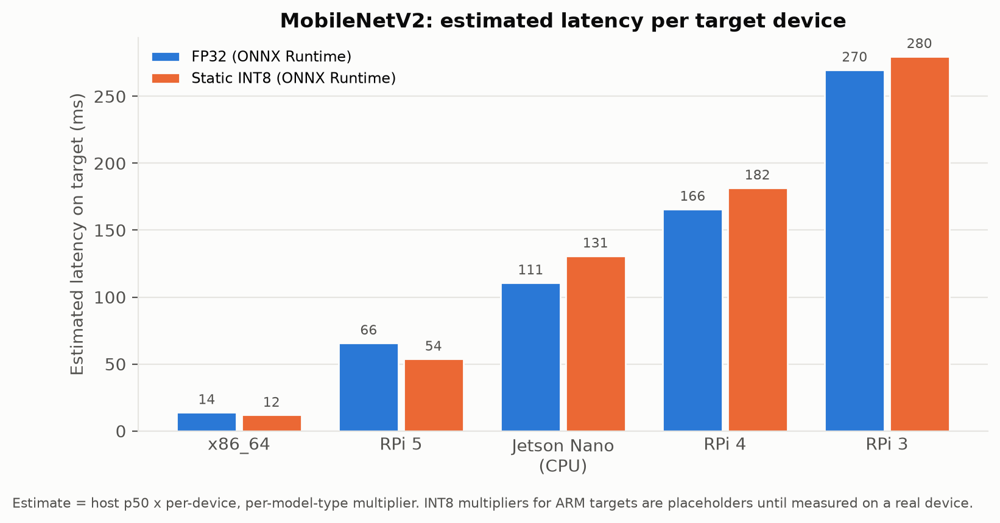

| Target | FP32 est. | Static INT8 est. | Winner (latency) |
|---|---|---|---|
| x86_64 | 13.9 ms (×1.0) | 11.9 ms (×1.0) | static INT8 |
| RPi 5 | 65.8 ms (×4.5) | 53.8 ms (×4.5) | static INT8 |
| Jetson Nano (CPU) | 110.7 ms (×8.2) | 130.8 ms (×10.7) | FP32 |
| RPi 4 | 165.8 ms (×11.8) | 181.6 ms (×15.3) | FP32 |
| RPi 3 | 269.7 ms (×18.5) | 279.8 ms (×24.0) | FP32 |

**Discussion:**
- **Size:** static INT8 is 3.5–3.9× smaller for every model.
- **RAM:** INT8 uses 1.8–3.6× less (MobileNetV2 43 → 23.5 MB, ResNet-152 518 → 144 MB).
- **Speed:** INT8's speed-up grows with model size, from 1.17× to 1.75×. Large regular
  convolutions benefit most from the CPU's INT8 instructions.
- **INT8 is slower on the two smallest models** (SqueezeNet 0.75×, ShuffleNet 0.87×).
  Converting values into and out of INT8 around every layer costs more than the tiny layers
  save. This is why EdgeMason always benchmarks FP32 next to INT8 and lets the measurement decide.
- **The target changes the winner:** INT8 wins on CPUs with fast INT8 instructions (x86 with
  VNNI, RPi 5); FP32 wins on the older ARM cores. The ARM INT8 multipliers are placeholders
  and must be measured on real devices.

### 5.5 Testing accuracy

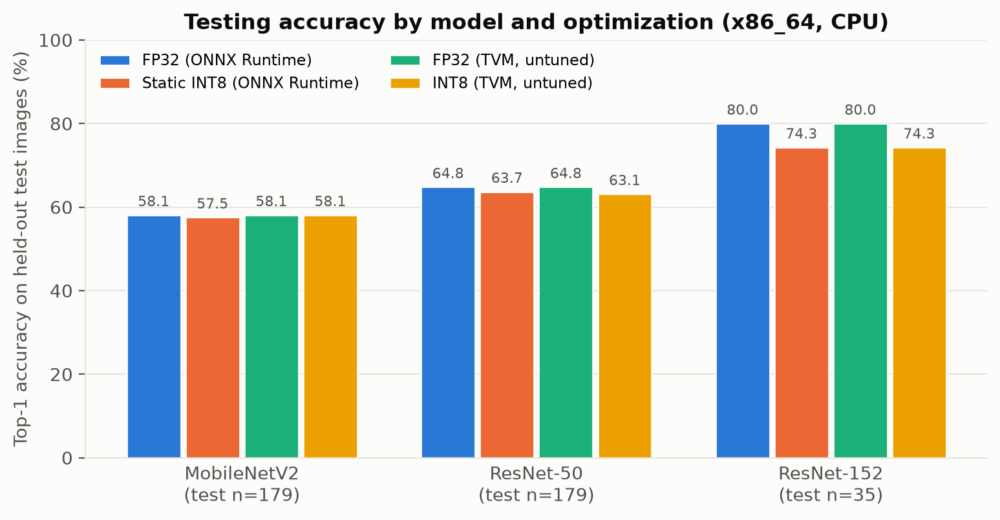

- **INT8 accuracy:** INT8 stays within 2.3 points of FP32 on top-1 for all six models.
  ResNet-18 INT8 is 1.1 points *above* FP32, and ResNet-152 is identical (68.7%).
  The gaps are 0–4 images out of 179, inside the ±7-point margin.
- **SqueezeNet** loses 2.2 points and agrees with FP32 on only 63% of predictions
  (section 5.7). It has no BatchNorm, so its value ranges are wide and harder to fit into INT8.
- **TVM gives the same FP32 accuracy as ONNX Runtime** on all three models, which shows the
  compilation is correct.
- **The ResNet-152 drop in the full-pipeline table (80.0% → 74.3%) is 2 images out of 35,**
  with only 15 calibration images. On the 179-image set, FP32 and INT8 are equal.

### 5.6 Calibration ("training") vs test ("validation") accuracy

Each model was quantized with 1, 2, 5, 10, 25, 50 and 100 calibration images (3 random
draws per size) and scored on a fixed test set of 156 images.

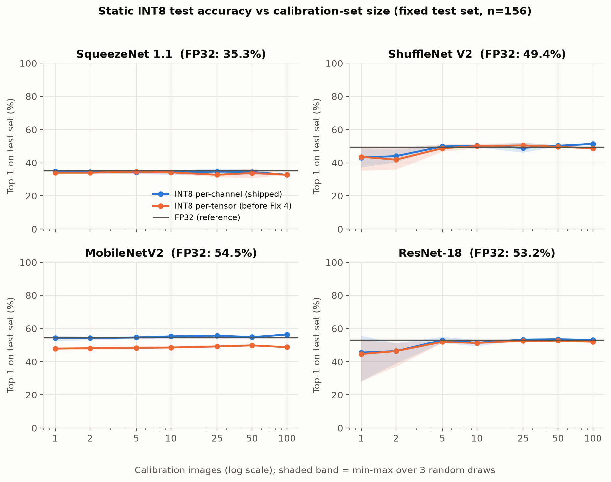

| Model | FP32 | 1 img | 2 img | 5 img | 10 img | 25 img | 50 img | 100 img |
|---|---|---|---|---|---|---|---|---|
| SqueezeNet 1.1 (per-channel) | 35.3% | 34.8% | 34.4% | 34.2% | 34.2% | 34.6% | 34.4% | 32.7% |
| ShuffleNet V2 (per-channel) | 49.4% | 43.2% | 44.0% | 49.8% | 50.2% | 48.9% | 50.2% | 51.3% |
| MobileNetV2 (per-channel) | 54.5% | 54.3% | 54.3% | 54.7% | 55.3% | 55.8% | 54.9% | 56.4% |
| ResNet-18 (per-channel) | 53.2% | 45.5% | 46.4% | 53.0% | 51.5% | 53.4% | 53.6% | 53.2% |
| SqueezeNet 1.1 (per-tensor) | 35.3% | 34.0% | 34.0% | 34.6% | 34.2% | 32.7% | 33.8% | 32.7% |
| ShuffleNet V2 (per-tensor) | 49.4% | 43.6% | 41.9% | 48.7% | 50.0% | 50.4% | 49.6% | 48.7% |
| MobileNetV2 (per-tensor) | 54.5% | 47.9% | 48.1% | 48.3% | 48.5% | 49.1% | 49.8% | 48.7% |
| ResNet-18 (per-tensor) | 53.2% | 44.7% | 46.4% | 51.9% | 51.3% | 52.6% | 52.8% | 51.9% |

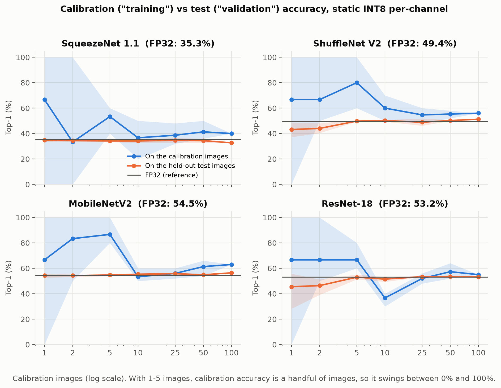

**Discussion:**
- **5–10 calibration images are enough** for these models. With 1–2 images, ShuffleNet and
  ResNet-18 lose 6–8 points and vary a lot between draws. From 5 images on, they match FP32.
  Beyond 10–25 images there is no consistent gain.
- **More calibration data does not fix per-tensor quantization.** MobileNetV2 per-tensor stays
  at ~48–50% from 1 to 100 images, while per-channel matches FP32 (~54–56%) even with 1 image.
  The weight-scale choice (Fix 4) matters far more than the amount of data.
- **More is not always better with MinMax calibration.** SqueezeNet drops to 32.7% at 100
  images: more images bring more extreme values, which widen the ranges. Percentile or entropy
  calibration is the usual remedy.
- **Calibration accuracy runs higher than test accuracy.** For example, at 100 images:
  MobileNetV2 63% vs 56%, ShuffleNet 56% vs 51%. That gap is the "fake accuracy" Fix 7 removed
  by grading only on held-out images. With 1–5 calibration images, calibration accuracy is a
  handful of images and swings between 0% and 100%.
- **Caveat:** with 156 test images each point is about ±8 points; small differences between
  neighbouring sizes are noise.

### 5.6.1 Effect of total dataset size (100–1000 images)

The study above varied only the calibration set inside the 256-image file. To test whether a
**larger overall dataset** changes the outcome, a second subset of **1000 ImageNetV2 images**
(one per class) was downloaded. It was shuffled once with a fixed seed into a **fixed 700-image
test set** and a 300-image calibration pool. Calibration subsets of 30, 77, 150, 225 and 300
images were drawn (up to three random draws each) and each quantized model was scored on the
same 700 images. These calibration sizes equal 30% of total datasets of 100, 257, 500, 750 and
1000 images, so each point corresponds to "a 30/70 split of a total dataset of this size", while
the fixed 700-image test set keeps every accuracy comparable at a tighter ±~3.7-point margin.

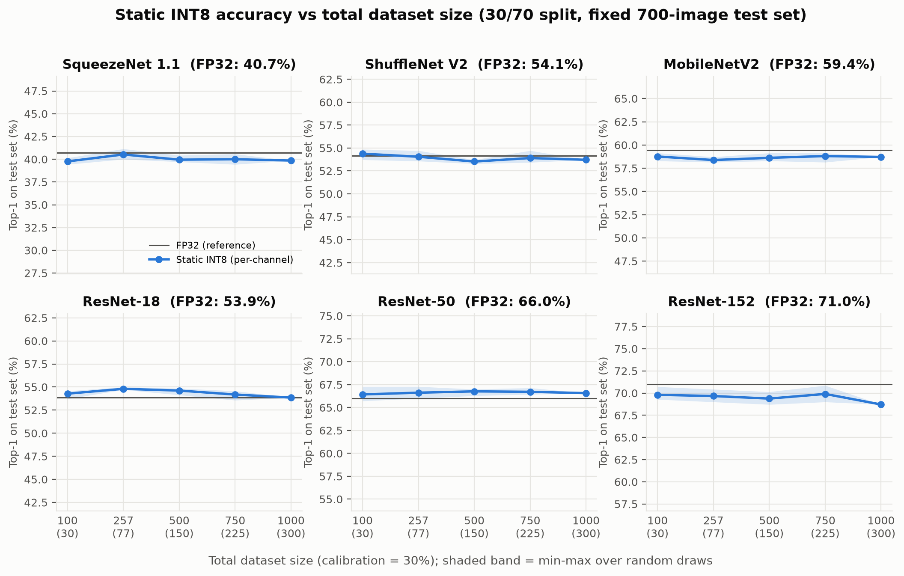

| Model | FP32 | 100 (30 cal) | 257 (77 cal) | 500 (150 cal) | 750 (225 cal) | 1000 (300 cal) |
|---|---|---|---|---|---|---|
| SqueezeNet 1.1 | 40.7% | 39.8% | 40.5% | 40.0% | 40.0% | 39.9% |
| ShuffleNet V2 | 54.1% | 54.4% | 54.0% | 53.5% | 53.9% | 53.7% |
| MobileNetV2 | 59.4% | 58.8% | 58.4% | 58.6% | 58.8% | 58.7% |
| ResNet-18 | 53.9% | 54.3% | 54.8% | 54.6% | 54.2% | 53.9% |
| ResNet-50 | 66.0% | 66.4% | 66.6% | 66.8% | 66.7% | 66.6% |
| ResNet-152 | 71.0% | 69.8% | 69.7% | 69.4% | 69.9% | 68.7% |

**Discussion.** The curves are flat for every model. Growing the total dataset from 100 to 1000
images, and with it the calibration set from 30 to 300 images, changes static INT8 top-1 accuracy
by at most about one point in either direction, which is inside the ±3.7-point margin of a
700-image test set. INT8 stays within ~1–2 points of FP32 throughout. This confirms the earlier
finding on the larger, more reliable test set: for these CNNs a few tens of calibration images
already saturate the quantizer, and adding more data neither helps nor hurts. The practical
implication is that EdgeMason's current warning threshold of 100 calibration images is
conservative; around 30 would be sufficient for these models. (The 256-image warning threshold
in Section V was raised to 1000 to make this experiment possible.)

### 5.7 Confusion matrices (FP32 vs INT8 agreement)

A 1000-class confusion matrix from 179 images would be almost empty (most classes have 0–1
images). The useful matrix for quantization is whether INT8 is right or wrong on the same
images where FP32 is right or wrong:

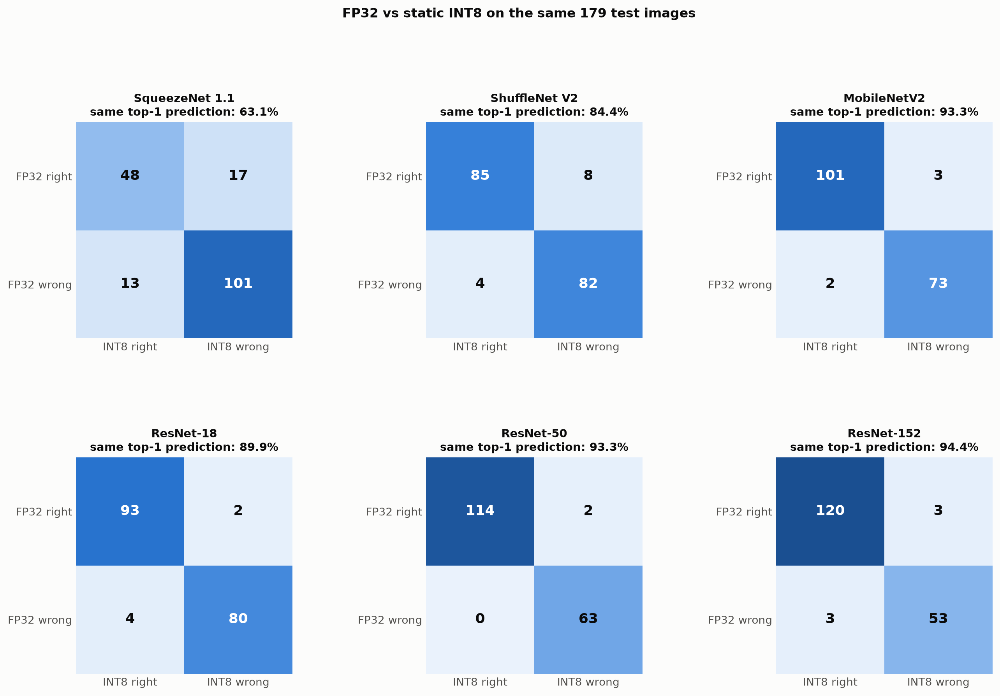

| Model | Both right | FP32 right, INT8 wrong | FP32 wrong, INT8 right | Both wrong | Same top-1 prediction |
|---|---|---|---|---|---|
| SqueezeNet 1.1 | 48 | 17 | 13 | 101 | 63.1% |
| ShuffleNet V2 | 85 | 8 | 4 | 82 | 84.4% |
| MobileNetV2 | 101 | 3 | 2 | 73 | 93.3% |
| ResNet-18 | 93 | 2 | 4 | 80 | 89.9% |
| ResNet-50 | 114 | 2 | 0 | 63 | 93.3% |
| ResNet-152 | 120 | 3 | 3 | 53 | 94.4% |

- **Off-diagonal cells are small** for MobileNetV2 and the ResNets (2–4 images each), so INT8
  makes almost the same decisions as FP32.
- **Agreement is highest for MobileNetV2 and the larger ResNets** (93–94%). SqueezeNet, which
  has no BatchNorm, is the outlier: 30 disagreements, 63% agreement.

### 5.8 Ablations

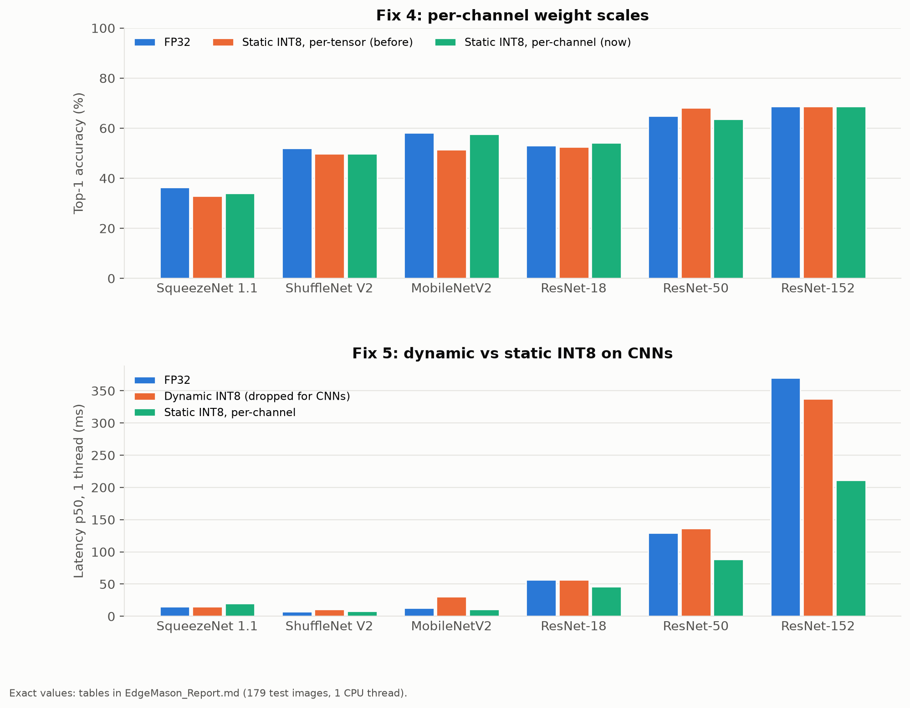

| Model | FP32 top-1 | INT8 per-tensor top-1 | INT8 per-channel top-1 | FP32 p50 | Dynamic INT8 p50 | Static INT8 p50 |
|---|---|---|---|---|---|---|
| SqueezeNet 1.1 | 36.3% | 33.0% | 34.1% | 14.8 ms | 15.3 ms | 19.9 ms |
| ShuffleNet V2 | 52.0% | 49.7% | 49.7% | 6.9 ms | 10.7 ms | 8.0 ms |
| MobileNetV2 | 58.1% | 51.4% | 57.5% | 12.7 ms | 30.3 ms | 10.9 ms |
| ResNet-18 | 53.1% | 52.5% | 54.2% | 56.4 ms | 56.8 ms | 46.0 ms |
| ResNet-50 | 64.8% | 68.2% | 63.7% | 129.2 ms | 136.3 ms | 88.3 ms |
| ResNet-152 | 68.7% | 68.7% | 68.7% | 370.0 ms | 337.9 ms | 211.2 ms |

- **Per-channel (Fix 4)** matters most for **MobileNetV2** (+6.1 points), whose depthwise
  convolutions have very different weight ranges per channel. For the other models the
  difference is within noise. ResNet-50 per-tensor at 68.2% is 8 images above per-channel,
  which is unexpected and inside the margin, so we don't read it as a real effect.
- **Dynamic vs static (Fix 5):**
  - **Static is faster than dynamic on 5 of 6 models,** and much faster on the larger ones.
    The exception is SqueezeNet, where dynamic (15.3 ms) is about level with FP32 (14.8 ms)
    and static is slower (19.9 ms).
  - **Dynamic is never the fastest option** for any of these CNNs.
  - **On MobileNetV2, dynamic is 2.4× slower than FP32.**
  - **On the two smallest models neither INT8 version beats FP32.**

### 5.9 TVM

- **It works:** TVM compiled and ran all three models (MobileNetV2, ResNet-50, ResNet-152)
  in FP32 and INT8, with the same FP32 accuracy as ONNX Runtime. The TVM package also runs
  (tested).
- **Untuned, it is 21–57× slower than ONNX Runtime FP32**
  (375 vs 17.5 ms; 6.6 s vs 131 ms; 20.9 s vs 368 ms).
- **What tuning means:** ONNX Runtime ships hand-optimized code for each operation. TVM
  *generates* code for each layer, and that code is only fast after **auto-tuning**:
  - TVM tries hundreds or thousands of variants (block sizes, loop order, vectorization,
    multi-core) on the target hardware and keeps the fastest.
  - This is TVM's MetaSchedule: `MetaScheduleTuneTIR` / `MetaScheduleTuneIRMod`, then
    `MetaScheduleApplyDatabase`.
  - For a Pi, the timing must happen on the Pi, through TVM's RPC.
- **Calibration does not make TVM fast.** TVM INT8 already uses the same calibration data
  (ONNX Runtime's static INT8 model, compiled by TVM). Calibration decides the INT8 *values*;
  tuning decides the *speed*.
- **Not built for ARM:** for Pi targets, `TVM_TARGETS` names the ARM CPU but does not set an
  ARM target triple, so the code is built for x86. TVM numbers for Pi targets are not real Pi
  numbers (Fix 13).

---

## 6. Validation

- **Tests:** 83 passed, 1 skipped (needs `torch`). They include tests that:
  - unzip the package and run `inference.py`
  - check `/health` answers while a deploy blocks
  - check per-channel scales
  - check the planner rules, the calibration split, ranking and memory measurement
- **Dashboard in Chrome, two full runs:**

  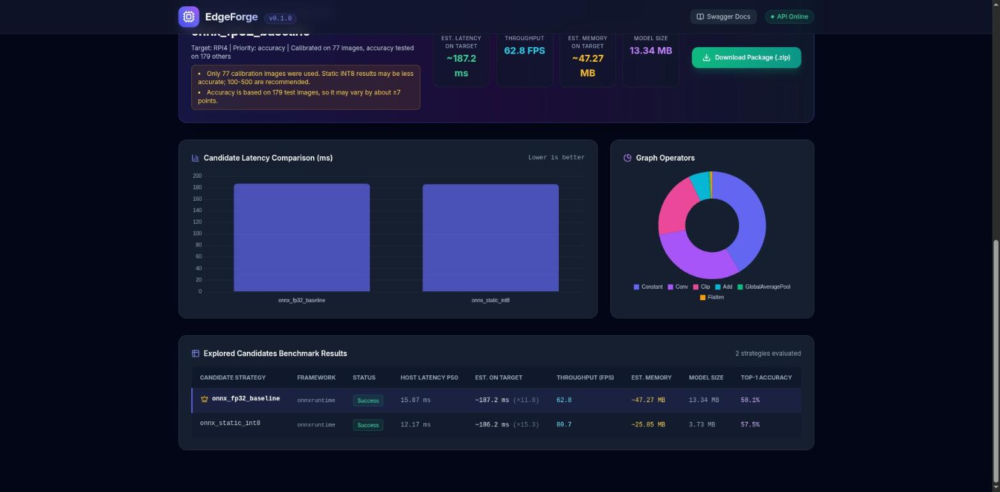

  - The RPi 4 run showed the estimates, the split, the warnings and the accuracy.
  - `/health` answered in 5–9 ms during the run.
  - The ZIP downloaded with all six files, and there were no console errors.
  - The x86_64 + Auto run used CUDA, where static INT8 cannot run. That now shows the GPU warning:

  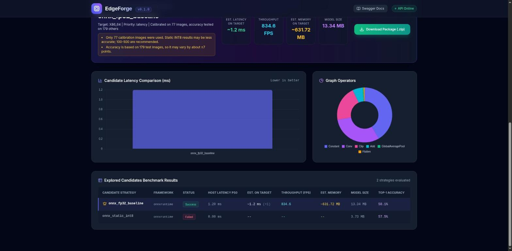

- **API matrix:** 11 deploys covering every target and every priority, plus 3 repeats.
  Data: `reports/data/validation_run_2026-10-05.json`.
- **Responsiveness:** 92/92 `/health` answers during a deploy, slowest 164 ms.
  Data: `reports/data/validation_responsiveness_2026-10-05.json`.
- **Package:** installed from `requirements.txt` in a brand-new Python 3.11 environment.
  12/20 real images were correct, and the self-test passed. The Docker build and run on x86
  also passed.

---

## 7. Limitations and open items

| Item | Status / what to do |
|---|---|
| INT8 latency multipliers for ARM targets | Placeholders; measure FP32 and INT8 once on a real RPi 3/4/5 and Jetson |
| Single-core estimates | Conservative; add a per-device multi-core factor measured on the device |
| ARM package | Not yet run on real ARM hardware |
| **Old-opset models** | Per-channel static INT8 produces an invalid model below opset 13 (ONNX Model Zoo SqueezeNet/ResNet-18 are opset 7–8). Option: upgrade the opset in the pipeline before quantizing, or warn the user |
| TVM | Untuned and built for x86; needs ARM cross-compilation and MetaSchedule tuning on the device (Fix 13). Keep it off in demos |
| x86_64 + Auto | Uses the GPU; static INT8 then cannot run (a warning is shown). Dashboards default to CPU |
| GPU estimates | Multipliers and memory readings are CPU-based; on CUDA, memory includes the CUDA libraries (~632 MB) |
| Fix 11 | ZIP deleted after the first download; download once |
| API default provider | Still `auto` (the dashboards default to CPU) |
| Accuracy ties | Differences of 1–2 images decide "accuracy" priority; consider treating differences inside the ± margin as a tie |
| No-winner reason | When every candidate breaks a limit, the response should say why |
| Accuracy scoring threads | Uses 1 thread like the benchmark; it could use all cores (untuned TVM scoring took ~45 min for ResNet-50) |
| Uploads | Streamlit's default 200 MB limit; a 1000-image file needs ~1.2 GB of server RAM |
| Dashboard polish | Provider column, operator chart (`Constant`), CDN dependencies, "EdgeForge" vs "EdgeMason" naming, TVM on by default |
| Commit | All changes are uncommitted on `abhay` |

---

## 8. Slide content: "Experimental Results and Discussion"

- **Performance analysis:**
  - Static INT8 is 3.5–3.9× smaller and uses 1.8–3.6× less RAM.
  - It is 1.17× (MobileNetV2) to 1.75× (ResNet-152) faster on one x86 core.
  - It is slower than FP32 on the tiniest models (SqueezeNet 0.75×, ShuffleNet 0.87×), so
    EdgeMason measures rather than assumes.
  - The winner changes with the target device.
- **Model setting and protocols:**
  - Six pretrained ImageNet CNNs (1.2 M–60 M parameters).
  - ImageNetV2, 256 images, seeded split: 77 calibration / 179 test.
  - Static INT8 per-channel (ONNX Runtime QDQ), dynamic INT8 for the ablation, TVM (untuned).
- **Benchmark setting:**
  - x86_64 i7-13620H, CPU provider, 1 thread.
  - 10 warm-up + up to 100 timed runs (10 s limit).
  - Each candidate in a fresh process; memory = peak − baseline.
  - Device latency = host × per-device multiplier.
- **Evaluation measures:**
  - Top-1/top-5 on held-out images (±7 points at n=179).
  - p50 latency and speed-up.
  - Model size and peak RAM.
  - FP32–INT8 agreement.
- **Testing accuracy graphs:** INT8 is within 2.3 points of FP32 on all 6 models
  (ResNet-152 identical); TVM matches FP32 exactly. Figures: `testing_accuracy_top1.png`,
  `summary_table.png`.
- **Training / validation accuracy:**
  - The calibration set plays "training", the held-out set "validation".
  - 5–10 calibration images are enough; 1–2 images lose 6–8 points on ShuffleNet and ResNet-18.
  - Calibration-set accuracy runs higher than test accuracy, the bias we removed by splitting.
  - Figures: `calibration_size_accuracy.png`, `calibration_vs_test_accuracy.png`.
- **Confusion matrices:** FP32 vs INT8 right/wrong. MobileNetV2 and the ResNets agree on
  90–94% of predictions; SqueezeNet (no BatchNorm) only 63%. Figure: `agreement_matrices.png`.

**Suggested figures for the slide:**
- `img/results/summary_table.png` (the table)
- `img/results/calibration_size_accuracy.png`
- `img/results/agreement_matrices.png`
- `img/results/latency_p50.png`

---

## 9. Reproducing everything

| Command | Produces |
|---|---|
| `uv run pytest -q` | 83 passed, 1 skipped |
| `uv run python scripts/run_full_benchmark.py` | `reports/data/full_run_x86_64*.json` (~70 min, mostly untuned TVM) |
| `uv run python scripts/quantization_analysis.py` | `reports/data/quantization_analysis.json` (~10 min) |
| `uv run python scripts/calibration_size_study.py` | `reports/data/calibration_size_study.json` (~17 min) |
| `uv run --with matplotlib python scripts/make_results_charts.py` | `reports/img/results/*.png` |
| `uv run --with matplotlib python scripts/results_tables.py` | markdown tables + `summary_table.png` |
| `uv run python scripts/measure_responsiveness.py` | Fix 12 numbers |

**Model setup:**
- **Download:** the three Model Zoo models come from `github.com/onnx/models`
  (`validated/vision/classification/...`).
- **Upgrade:** they were upgraded to opset 13 with `onnx.version_converter.convert_version(model, 13)`
  and saved as `models/*-13.onnx`.
- **Not in git:** `models/` is gitignored.
